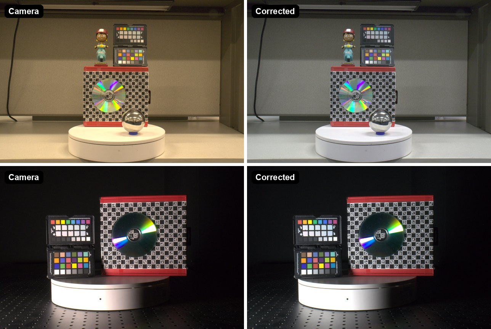
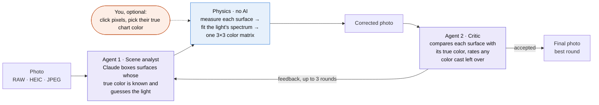

# Natural Color Charts

**Color correction without a color chart.** Two Claude agents find everyday surfaces whose true
color is known (leaves, skin, white paint, gray concrete) and check each other's work. A physics
model turns those surfaces into one color correction for the whole photo, so no pixel is ever
generated or invented.

**[Live demo and gallery →](https://parishamaheshj18.github.io/context-based-color-correction/)**



<sub>The color charts in these photos were blacked out before the agents saw them; they are used
only to score the result.</sub>

---

## The problem

Accurate color needs two things: the color of the light in the scene, and how the camera responds
to light.

- **Color charts** solve this: photograph a printed chart and fit a correction to its known
  patches. Almost no real photo contains one.
- **Auto white balance** guesses instead, assuming the scene averages to gray. A green forest, a
  red wall or warm indoor light fools it, and it only adjusts three channel gains.
- **Generative editing** can make a photo look better, but it can also change what is in it.

**The idea:** use the scene itself as the color chart. Healthy leaves, skin, white paper and gray
concrete reflect light in ways that are physically predictable. If an AI can find them and judge
which ones to trust, physics can work out the light and correct the photo.

## How it works



1. **Agent 1 reads the scene.** Claude names the light sources, picks surfaces whose true color is
   known, boxes them, and flags risky ones (autumn leaves, shade, glossy highlights). It also maps
   the user's request, such as "keep the warm evening mood", to how far the correction goes.
2. **Physics measures.** Each box is cleaned of edges, highlights and clipped pixels, and its color
   is measured in the camera's raw, linear values.
3. **Physics corrects.** From the camera's spectral sensitivity and each material's reflectance
   spectrum, the pipeline fits the light's spectrum and builds one global 3×3 color matrix.
4. **Agent 2 critiques.** An independent Claude call sees the before and after, with every surface
   shown next to its true color and the measured difference, and judges each one.
5. **Revise or deliver.** Agent 1 reads the critique and revises its references. The loop stops when
   the critic accepts with nothing in doubt, when a revision doesn't improve, or after 3 rounds,
   and the best round is delivered.

## The two agents

| | Agent 1 · Scene analyst | Agent 2 · Critic |
|---|---|---|
| **Sees** | The photo and the user's request; when revising, the critic's feedback and the measurements | A review sheet: before/after with numbered boxes, and each surface's corrected color beside its true color, with ΔE |
| **Returns** | Light hypotheses, reference surfaces with boxes and confidence, intent; when revising, also a trust score (0–1) for each of the user's color matches | A verdict per surface (consistent, doubtful or wrong), the remaining cast and its severity, suggestions, accept or not |
| **Code** | [`context/analyzer.py`](src/natural_color_charts/context/analyzer.py) | [`review/critic.py`](src/natural_color_charts/review/critic.py) |

**Design choices that keep the agents honest:**

- **Agents never touch pixels.** They decide *which* surfaces to trust; every pixel comes from one
  global matrix computed by physics.
- **The critic is grounded in measurements.** It compares two colors side by side, which models do
  far better than judging "is this gray?". The expected color and its normal range come from
  each material's reflectance prior ([`review/evidence.py`](src/natural_color_charts/review/evidence.py)).
- **The critic is independent.** It never sees Agent 1's reasoning, so it cannot just agree. Agent 1
  is told the critic can be wrong too, and explains its disagreements.
- **Only improvements are kept.** A revision that doesn't beat the best round ends the loop
  ([`review/loop.py`](src/natural_color_charts/review/loop.py)).
- **The human goes first, the agents decide.** In the matching window you click pixels whose true
  chart color you know. The agents can lower their trust in, or ignore, a match that disagrees
  with the rest of the scene.
- **Validated and reproducible.** Every answer must match a JSON schema (Pydantic, retried with the
  validation error if it doesn't) and is cached on disk, so the showcase rebuilds exactly and
  for free.

## Results

All 10 photos were corrected by the full agent loop (22 critic reviews in total). Two of
them contain a color chart, which is blacked out before either agent sees the photo and used
only for scoring. Each cell is the error in the estimated light color (degrees) / the mean
color error on the chart's 24 patches (ΔE00); lower is better.

| Photo (chart hidden from the agents) | Camera | Gray world | Before agent review | **With agent review** |
|---|---|---|---|---|
| Warm room light on a shelf (Canon EOS Rebel T8i) | 8.41° / 10.7 | 2.03° / 7.2 | 1.56° / 6.7 | **1.42° / 6.6** |
| Spot-lit stage on a black background (Canon EOS Rebel T8i) | 2.10° / 7.1 | 2.69° / 7.7 | 1.71° / 7.0 | **1.71° / 7.0** |

On the warm office photo the critic flagged the gray fabric wall as doubtful; Agent 1 dropped it as
"likely beige-tinted", and the error fell from 1.56° to 1.42°. On the dark stage the critic accepted
the first correction. Two photos are only spot checks, not a benchmark.

How the loop behaved on every photo (severity: 0 is perfect, 1 is badly off):

| Photo | Camera | Rounds | Critic severity per round | Why the loop stopped |
|---|---|---|---|---|
| Warm room light on a shelf | Canon EOS Rebel T8i | 2 | 0.15 → 0.08 | the critic accepted the correction |
| Spot-lit stage on a black background | Canon EOS Rebel T8i | 1 | 0.07 | the critic accepted the correction |
| Eastern bluebird on a shrub | Apple iPhone 16 Pro | 2 | 0.65 → 0.65 | the last revision did not improve on round 1 |
| Forest trail in deep shade | Apple iPhone 16 Pro | 3 | 0.20 → 0.15 → 0.15 | the last revision did not improve on round 2 |
| Conservatory fountain under a glass roof | Apple iPhone 14 Pro Max | 2 | 0.10 → 0.12 | the last revision did not improve on round 1 |
| Red roses in a kitchen | Apple iPhone 13 Pro | 2 | 0.10 → 0.08 | the critic accepted the correction |
| Bronze sculpture in a tropical garden | Apple iPhone 13 Pro | 3 | 0.10 → 0.08 → 0.08 | the last revision did not improve on round 2 |
| Friends at a lake overlook | Apple iPhone 13 Pro | 3 | 0.12 → 0.10 → 0.08 | the round limit was reached |
| Group photo at a waterfall | FUJIFILM X-T30 | 2 | 0.10 → 0.15 | the last revision did not improve on round 1 |
| Riverside trail on a sunny afternoon | unknown | 2 | 0.10 → 0.10 | the last revision did not improve on round 1 |

The hardest case is the bluebird: leaves are its only reference, and using leaves requires the
camera's spectral curves, which don't exist for the iPhone 16 Pro. The physics falls back to a
statistical estimate, and the critic correctly flags the result as too cool. Assuming another
iPhone's curves made it far worse (severity 0.95), so that shortcut was rejected.

Browse every photo, round and critique in the
**[gallery](https://parishamaheshj18.github.io/context-based-color-correction/#gallery)**.

## Try it

Requires Python 3.11+ and an Anthropic API key for the agents.

```bash
git clone https://github.com/parishamaheshj18/context-based-color-correction.git
cd context-based-color-correction
python -m venv .venv && source .venv/bin/activate
pip install -e ".[anthropic,heic,dev]"
echo "ANTHROPIC_API_KEY=sk-ant-..." > .env      # git-ignored

# Correct one photo with both agents; writes corrected images, report.json,
# review.json and the review sheets the critic saw to outputs/<photo>/
ncc correct photo.dng --vlm anthropic --detector vlm

# Open the matching window: your color matches first, then the agents take over
ncc match photo.dng

# Rebuild the website from showcase/cases.yaml (needs the photos it lists,
# which are not in the repository; cached agent answers make reruns free)
ncc showcase

# Run the tests, linter and type checker
pytest && ruff check src tests && mypy src
```

Every setting, including the number of review rounds and the critic model, lives in
[`configs/default.yaml`](configs/default.yaml) and can be overridden on the command line, for
example `--set review.max_rounds=1`. Without an API key the pipeline still runs with a
model-free default context and the classic baselines.

## Project structure

```
src/natural_color_charts/
├── context/      Agent 1: prompt, JSON schema, scene analysis and revision
├── review/       Agent 2 and the loop: evidence, review sheet, critic, stop rules
├── io/           RAW / HEIC / JPEG loading, EXIF, previews
├── camera/       camera spectral sensitivity data and selection
├── detection/    reference regions: boxes, segmentation, patch statistics
├── spectral/     reflectance priors, illuminant models
├── estimation/   spectral illuminant fit and classic baselines (gray world, ...)
├── correction/   spectral 3×3 color matrix, chromatic adaptation, rendering
├── evaluation/   chart-based scoring, benchmarks, ablations
├── reporting/    report.json, overlays, the showcase site builder
├── gui/          the matching window
└── pipeline.py   stage orchestration; pipeline_factory.py builds it from the config
site/             the static website (GitHub Pages)
showcase/         the photo manifest and cached agent answers
tests/            124 tests (pytest)
```

The architecture follows SOLID: every stage is a small `typing.Protocol`, concrete classes are
created only in `pipeline_factory.py`, and domain objects are frozen dataclasses.

## Built with

**AI agents:** Claude API (Opus), structured JSON outputs, a two-agent critique loop, Pydantic
validation with retries, response caching.
**Color science:** spectral illuminant estimation, camera spectral sensitivities, PCA reflectance
priors, chromatic adaptation (Bradford), CIELAB and ΔE2000, RAW decoding with LibRaw (`rawpy`),
`colour-science`.
**Engineering:** Python 3.11, NumPy, SciPy, OpenCV, Typer CLI, pytest, mypy (strict), ruff,
GitHub Actions for CI and Pages.

## Limitations and next steps

- **Only 2 of the 10 showcase photos contain a color chart**, so the numbers above are spot checks,
  not a benchmark. The next step is a run on a public dataset such as Gehler–Shi or NUS 8-camera.
- **Camera curves.** Spectral sensitivity data is available for a set of phone cameras (the
  author's own dataset, not included here) and two cameras that ship with `colour-science`.
  Without it (for example for the Canon EOS Rebel T8i), the spectral fit is skipped and a
  simpler neutral-surface estimate plus the camera's own matrix are used, which leaves a visible
  ΔE00 of about 6–7 even when the white balance is close.
- **Processed photos.** HEIC and JPEG files are already white-balanced and tone-mapped by the
  camera, so they are corrected in an approximate mode; RAW gives the best results.
- **Reflectance priors** are starter versions built from color-chart spectra. Measured libraries
  (such as ECOSTRESS and skin datasets) would tighten them and make the critic stricter.
- **A safer fallback.** When the critic rates every round as badly off (as on the bluebird), the
  loop still delivers its best correction; delivering the camera's own colors would be better.
- **Mixed lighting.** One global matrix cannot fix a face in shade next to a sunlit wall; per-zone
  illuminants are a natural extension.

## Author

Built by **Parisha** ([@parishamaheshj18](https://github.com/parishamaheshj18)).
